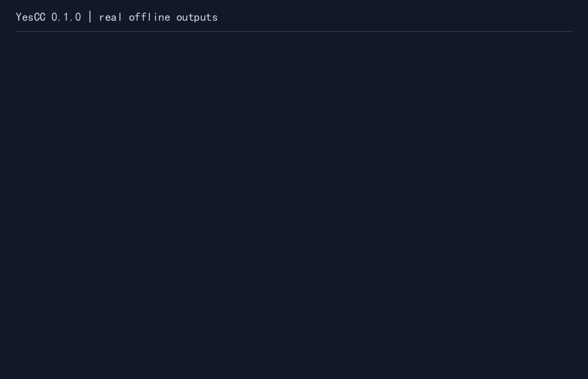

# YesCC（Yes Compiler Collection）

[](https://github.com/wuqiuwangtian/yescc/actions/workflows/ci.yml)

> **The compiler that never says no.**
> 语法是可选的，编译是必然的。

YesCC 是一个「永不扫兴」的 AI 编译器：正确代码原样编译；错误代码尽力修复；连自然语言或胡言乱语，也尽量变成一个能运行的程序。

- **正确代码绝不打扰**：原生工具链成功即结束，不改源码、不调模型、不注入参数。
- **错误代码尽力挽救**：规则 → 便宜/本地模型 → 强模型，每层都交真实工具链验证。
- **无意义输入也给出创造性解释**：确定性兜底、文化梗、模型创意解释；结果状态单独标注，绝不冒充原程序。



图中为实际离线输出；创意兜底仅回显输入，不表示实现原始意图。

## 当前状态

**v0.0.1-alpha（0.0.1a2）已发布**（[release](https://github.com/wuqiuwangtian/yescc/releases/tag/v0.0.1-alpha)）：三语言原生直通、C 规则修复、模型修复、自然语言生成与创意兜底可用；AI 产物默认在最小沙箱中运行。这是 alpha，接口与行为仍可能变化。

仓库中的后续修复不代表已更新 TestPyPI 安装包；当前开发状态、未发布变更和接续任务统一见[路线图 §10](docs/项目路线图与发布计划.md#10-待决事项与下一步)。

当前源码版本为 `0.1.0`，正在准备正式发布资产；尚未上传正式索引或创建新 Release。固定基准、安装验收与费用见[评测入口](docs/评测/README.md)，待完成项统一见路线图 §10。

模型创意兜底的真实作品、失败原因与评分口径见[创意质量专项](docs/评测/2026-11-12.md#7-改进后完整复测与推理设置)。模型作品、固定梗和原文回显分别统计；可运行不等于作品质量。

约束提取与独立自检的[离线研究](docs/评测/2026-11-13.md)单独评估识错、误拒绝和开销，尚未接入默认创意流程。

首版范围：C 为 AI 修复/生成目标；Python / C / JavaScript 保留原生直通；MIT 许可，PyPI + 独立二进制发布。长期目标「所有语言」与「编辑器插件」不变。进度见[路线图](docs/项目路线图与发布计划.md)。

> 开发代号曾为 `fcomp`；仓库、包名与命令已统一为 `yescc`。

## 安装（alpha）

TestPyPI 预览版，依赖仍从 PyPI 拉取：

```bash
pipx install --index-url https://test.pypi.org/simple/ \
  --extra-index-url https://pypi.org/simple/ yescc==0.0.1a2
yescc --version
```

也可以 `uv tool install` 或从源码运行（见下）。

## 免安装二进制（发布候选）

候选包保存在 GitHub Actions 的 `Release candidate assets` 工作流 artifact 中，尚未正式发布。Linux x86_64 使用 tar.gz，Windows x86_64 使用 zip；下载后解压并保留整个目录（包含 `_internal`、`licenses`），直接运行 `./yescc --version` 或 PowerShell 的 `.\yescc.exe --version`。CLI 自带运行时，无需安装 YesCC 的 Python 包。

用户程序仍需要对应工具链在 PATH：C 用 GCC，JavaScript 用 Node.js，Python 用可运行的 Python 3。二进制按 PATH 选择外部 Python；wheel 安装继续使用其所在环境的解释器。Linux 正式候选在 Ubuntu 24.04 构建，记录 glibc 基线，不保证旧 Linux、musl/Alpine、ARM 或 macOS 可用；Windows 候选内置 Python 3.14，其[最低平台为 Windows 10+](https://docs.python.org/3.14/using/windows.html#supported-windows-versions)；本项目仍只以原生 CI 验证范围为准。

解压后在该目录执行：

```bash
./yescc run examples/hello.c --offline        # hello
./yescc run examples/broken.c --offline       # repaired
./yescc run examples/idea.txt --offline       # 明示 creative_fallback，回显输入
```

默认输出保持用户程序原样；若要确认修复状态，可执行 `./yescc examples/broken.c --explain --offline` 读取刚才的报告。

Windows 将 `./yescc` 换为 `.\yescc.exe`。若程序提示缺工具链，先安装对应工具链；二进制不捆绑 GCC/Node 或用户项目依赖。候选的 `MANIFEST.json`、`SHA256SUMS` 和实际许可证审计用于核对资产；许可未知项未清零前不进行正式分发。

## 快速开始

需要 Python ≥3.11、[uv](https://docs.astral.sh/uv/) 和 PATH 中的 GCC。在已检出的源码仓库根目录运行（开发分支见路线图 §10）：

```bash
uv sync --locked
uv run yescc --version
uv run yescc run examples/hello.c --offline    # 输出 hello，原生直通
uv run yescc run examples/broken.c --offline   # 输出 repaired，规则修复
uv run yescc run examples/multi_error.c --offline --no-fallback  # 输出 value=7，多错误 C
uv run yescc run examples/idea.txt --offline   # 明示 creative_fallback
uv run yescc examples/broken.c --explain       # 查看刚才的报告
```

上述四例不需要模型密钥。`--offline` 禁止模型请求；最后的 `idea.txt` 演示本地确定性创意兜底，并非按原意修复。源码中的全角分号是故意保留的错误，YesCC 的修复产物另存。

报告写入 `.yescc/<文件名>/report.json`；源文件不会被覆盖。

## 能力矩阵（当前源码）

| 能力 | Python | C | JavaScript |
| --- | --- | --- | --- |
| 原生直通 | 是 | 是 | 是 |
| 规则修复 | 规划 0.2 | 是 | 规划 0.2 |
| 模型修复 | 规划 0.2 | 是 | 规划 0.2 |
| 自然语言生成 | 规划 0.2 | 是 | 规划 0.2 |
| 创意兜底 | 是 | 是 | 是 |
| 运行 | 是 | 是 | 是 |

Windows 原生安装、隐私数据流、清理方式和 FAQ 见[使用与隐私指南](docs/使用与隐私指南.md)。模型补丁按唯一精确旧文本定位，可重算错误行号/行数；原始 diff 与调整说明保留在报告，正文不匹配、歧义和重叠仍拒绝，见 [ADR-0017](docs/adr/0017-exact-context-patch-normalization.md)。

## 模型配置

默认读取环境变量；密钥只放在环境变量或本地 env 文件里，不要写进配置或仓库：

```bash
export YESCC_MODEL_L3_PROVIDER=deepseek
export YESCC_MODEL_L3_BASE_URL=https://api.deepseek.com/v1
export YESCC_MODEL_L3_NAME=deepseek-flash
export YESCC_MODEL_L3_API_KEY=...
export YESCC_MODEL_L3_INPUT_PRICE_PER_MTOK=...   # 当前输入单价，USD/百万 token
export YESCC_MODEL_L3_OUTPUT_PRICE_PER_MTOK=...  # 当前输出单价，USD/百万 token
export YESCC_MODEL_L2_BASE_URL=http://localhost:11434/v1   # 可选，本地小模型
export YESCC_MODEL_L2_NAME=llama3.2
```

常用开关：`--offline`（不发模型请求）、`--budget 0.05`（USD）、`--max-rounds 2`、`--no-cache`、`--trace`、`--emit-source`。没有可用密钥时自动降级为规则 + 确定性兜底。

推理与输出额度可调整，仍共享同一任务预算：

```bash
# 已按上面配置DeepSeek、密钥和当前价格；直接创作，不先花额度修复
uv run yescc run examples/idea.txt --play --thinking disabled --budget 0.005
# 愿意用更多输出额度思考时显式开启；实际额度仍会按剩余费用下调
uv run yescc run examples/idea.txt --play --reasoning-effort low --max-output-tokens 4096 --budget 0.005
```

DeepSeek普通模型默认显式禁用thinking，选择推理等级会开启；OpenAI使用其reasoning_effort，不接受DeepSeek式thinking开关。具体模型支持的等级不同，兼容端点不会自动获得这些能力。环境可用`YESCC_MODEL_L3_THINKING/REASONING_EFFORT/MAX_OUTPUT_TOKENS`（L2同理）；CLI覆盖环境，thinking/effort的显式auto重置该项为项目默认。输出默认上限仍1024，最大可设16384，不增加费用或候选次数。完整规则见[模型控制与创意检查](docs/adr/0021-creative-quality-and-model-controls.md)。

模型创意的`run`先检查退出、非空UTF-8和64KiB合计输出额度，坏候选在原上限内重试；`build`只编译和检查有限源码风格，**不执行程序**。报告分别记录`source_checks`和`generated.validation`；检查通过仍不保证有趣、贴题或完整。原生程序不受这些创意输出限制。

有限源码检查也会拒绝`'☀'`等普通非ASCII字符常量，要求用完整UTF-8字符串。另有[离线一致性评测器](bench/README.md#创意一致性回归)，核对冻结题目的显式输出约束；它不在生产运行中裁决作品语义。

云端模型必须配置两项单价，未知价格时不发请求；请求前保守估算并预留费用，剩余预算限制输出 token。缺 usage 或请求失败会保留预留，`model.cost_known=false` 时费用总额未知，`cost_usd` 只表示已知部分小计。回环本地端点可不填价格，但不能声称受到金额限制。`--max-rounds` 同时限制候选尝试（含缓存）与实际请求；L2 修复失败后有 L3 就升级，显式 `--model` / `--provider` 跳过自动 L2。详见 [ADR-0015](docs/adr/0015-alpha-reliability-contracts.md)。

C 规则阶段最多构建 24 个候选、每条路径最多细化 4 次；可组合机械标点/拼写错误并使用 GCC 的分号建议。遇到 C++ 写法或语义错误仍可能无法修复。确定性兜底会在 stderr 和报告中说明模型路径与失败原因；`print_input` 只回显输入。规则与报告边界见 [ADR-0018](docs/adr/0018-bounded-rule-refinement-and-degradation.md)。

构建/解释模式的 `--json` 在可预期命令错误时也返回一个 JSON 对象：若 `report_kind` 为 `command_error`，读取 `error.exit_code` / `error.message`；否则按原 schema v1 构建报告处理。错误对象只输出到 stdout，不覆盖旧构建报告。显式指定不支持的 `--lang`（包括带 `--play` 时）返回 101，不进入创意兜底；已支持的语言别名保留。`--no-fallback` 不改退出码分类：用法 100、不支持输入 101、构建失败 102、预算等限制 103。见 [ADR-0019](docs/adr/0019-command-error-json-envelope.md)。

## 已知限制

- 只支持单文件；跨文件与项目构建不支持，未识别语言返回退出码 101。
- 源码仅支持 UTF-8（可带 BOM）。
- Windows 上原生调用（非 WSL），C 工具链使用系统 GCC/MinGW；MSVC 不支持。
- 部分 MinGW 链接器不支持含非 ASCII 字符的绝对输出路径；可在目标工作目录使用相对输出文件名。此类原生工具链失败会如实保留。
- 通过管道重定向时，用户程序自身的编码设置仍生效，YesCC 不替用户程序改写环境。
- 沙箱是「尽力隔离」：独立临时目录、超时、环境变量白名单、POSIX 资源限额；**不是安全边界**。Linux 上 `unshare -n` 无权限时不会断网。POSIX 清理独立进程组；Windows 以 `taskkill /T` 尽力清理超时/中断的进程树，没有 Job Object，不保证清理已脱离任务树的后代。
- AI 产物默认使用临时 cwd，相对路径不再指向原目录；绝对路径仍可访问宿主文件。需要真实 cwd 与环境时使用 `--unsafe-run`，仍保留超时和进程清理。
- `--offline` 控制 YesCC 的模型请求，不改变原生用户程序的网络行为。费用估算依赖配置单价和服务遵守 token 限额，不能约束供应商隐藏计费；HTTP 分阶段超时也不是操作系统级的任务硬截止。

## 文档

- [初版需求报告](docs/初版需求报告.md)：完整愿景、兼容性边界、命令行体验、处理流程、性能成本、验收和分期。
- [技术参考与验证计划](docs/技术参考与验证计划.md)：程序修复研究、工具链与编辑器依据、实验设计。
- [GitHub 开源项目调研](docs/GitHub开源项目调研.md)：5 个相关候选，区分创意参照、修复组件与真实执行后端。
- [项目路线图与发布计划](docs/项目路线图与发布计划.md)：里程碑与验收门、技术契约、MIT 许可与 GitHub + PyPI 发布流程。
- [ADR 索引](docs/adr/README.md)：已确认的架构与产品决策。
- [评测记录](docs/评测/2026-11-03.md)：M1 原生一致性与包装开销 baseline。

## 开发

```bash
uv sync --extra dev
uv run ruff check .
uv run mypy
uv run pytest
```

真实模型评测不在 CI 中执行，记录写入 [docs/评测](docs/评测/README.md)。

固定 200 例基准和离线/真实/暖缓存模式见 [bench/README](bench/README.md)。离线执行明确区分 130 个已评测样本和 70 个模型任务未评测；Linux/Windows CI 保留各自原始 JSON。

接手开发先读 [AGENTS.md](AGENTS.md) 和[路线图 §10](docs/项目路线图与发布计划.md#10-待决事项与下一步)；贡献流程见 [CONTRIBUTING.md](CONTRIBUTING.md)。

## 许可

[MIT](LICENSE) © 2026 五秋望田（wuqiuwangtian）


## English summary

YesCC wraps Python, GCC and Node.js. Valid programs use their native toolchain
without model calls. C errors may be repaired with rules or bounded model attempts;
every candidate is compiled before use. Natural-language generation targets C.
Creative fallback is reported separately. Source files are preserved. AI execution
uses best-effort isolation and is not a security boundary. The current source RC
has not been published; see the roadmap for verification and remaining release work.
